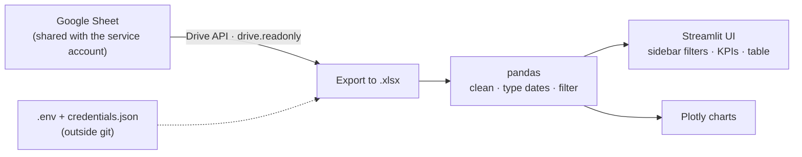

<div align="center">


# Data Sentinel

### Decision dashboard for a sensitive operational dataset

A Streamlit panel that reads a spreadsheet kept in Google Drive through a read-only service account,
then turns it into filters, KPIs and interactive Plotly charts. Credentials stay outside the code.

[](https://n3xus.dev)
[](LICENSE)

[](Dockerfile)
[](delduquedatasentinel/requirements.txt)
[](delduquedatasentinel/requirements.txt)
[](delduquedatasentinel/requirements.txt)
[](delduquedatasentinel/app.py)
[](Dockerfile)

</div>

---

## Table of Contents

- [Overview](#overview)
- [What it does](#what-it-does)
- [Architecture](#architecture)
- [Quickstart](#quickstart)
- [Configuration](#configuration)
- [Repository structure](#repository-structure)
- [Security model](#security-model)
- [Current status](#current-status)

---

## Overview

**Data Sentinel** is built around a shared Google Sheet used as a team's source of truth. Instead of emailing
copies of the spreadsheet around, everyone opens one panel that pulls the latest version, applies filters and
shows what changed.

It is built for:

- small teams whose source of truth is a spreadsheet they can't replace yet;
- managers who need KPIs and trends without editing the raw data;
- data that should be read through a least-privilege account, never shared publicly.

---

## What it does

| Feature | Details |
|---|---|
| **Fresh data on load** | Exports the Google Sheet to `.xlsx` through the Drive API (`drive.readonly` scope) |
| **Filters** | Responsible person, category, state and date range, in the sidebar |
| **KPIs** | Total records, distinct categories, new records in the last 30 days |
| **Charts** | Top 10 responsibles, records over time and distribution by category (Plotly) |
| **Table** | Preview of the filtered rows |
| **Multi-tab** | Pick which sheet tab to analyse |

---

## Architecture



---

## Quickstart

```bash
git clone https://github.com/Samurai33/delduque-data-sentinel.git
cd delduque-data-sentinel
python -m venv .venv && source .venv/bin/activate      # Windows: .venv\Scripts\activate
pip install -r delduquedatasentinel/requirements.txt
streamlit run delduquedatasentinel/app.py
```

### With Docker

```bash
docker build -t data-sentinel .
docker run -d -p 8501:8501 --env-file .env \
  -v "$(pwd)/credentials.json:/app/credentials.json:ro" data-sentinel
```

Open <http://localhost:8501>.

---

## Configuration

1. Create a Google Cloud service account and download its `credentials.json` to the project root.
2. Share the spreadsheet with the service account's e-mail, as **viewer**.
3. Put the file ID in `.env`:

```bash
GOOGLE_DRIVE_FILE_ID=<spreadsheet id>
```

---

## Repository structure

| Path | What it is |
|---|---|
| `delduquedatasentinel/app.py` | Streamlit app: Drive export, data prep, filters, KPIs, charts |
| `delduquedatasentinel/drive_config.py` | Reads `GOOGLE_DRIVE_FILE_ID` from the environment |
| `delduquedatasentinel/requirements.txt` | Pinned Python dependencies |
| `Dockerfile` | Python 3.13 slim image serving Streamlit on port 8501 |
| `DEPLOY_ORACLE_CLOUD.md` | Notes for deploying on an Oracle Cloud VM |

---

## Security model

- **Read-only access.** The service account only gets the `drive.readonly` scope and viewer access to one file.
- **No secrets in git.** `credentials.json` and `.env` are mounted at runtime and ignored by git.
- **No public exposure by default.** Put the panel behind an authenticating proxy or a VPN; Streamlit has no
  login of its own.

---

## Current status

| | |
|---|---|
| **Stage** | Working panel; no real data is stored in this repository |
| **Runs on** | Local Python or Docker |
| **Not included** | Authentication, automated tests, write-back to the sheet |

---

<div align="center">

**Need something built, secured or kept online?** → [samurai@n3xus.dev](mailto:samurai@n3xus.dev) · [n3xus.dev](https://n3xus.dev)

MIT © Thiago "Samurai" Rangel · [N3XUS](https://n3xus.dev)

</div>
